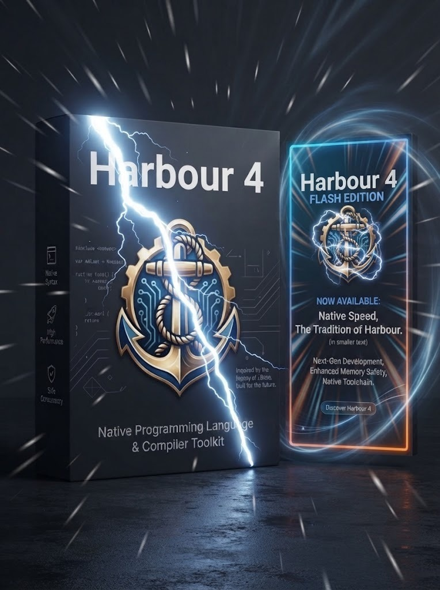

# HarbourRust

Write Harbour. Run native. Rust architecture.



HarbourRust is an ahead-of-time native compiler for Harbour, written in Rust. **It is NOT a Harbour-to-Rust translator.** Its ordinary path compiles supported Harbour source to x86-64 machine code and packages it with its own ELF, PE32+ or experimental Intel Mach-O writer. No Rust source is generated, and no Rust toolchain is involved when using an already-built `hbc`. Rust is the implementation language of the compiler, not an intermediate language for your program. There is no VM or interpreter. Support grows construct by construct, with byte-for-byte checks against the original Harbour compiler wherever applicable and explicit records of known differences. Unsupported syntax is rejected explicitly at compile time. Harbour sources in this repository use the standard `.prg` extension.

## Memory model

No VM, no pcode, no garbage collector. Ownership checked at compile time, with deterministic release and no pause times; one limited persistent-value path uses reference counting (see below). In the same family of GC-free designs as Rust and the recent Goose language.

## Dyn heap floats

Kind-5 Dyn values now keep their double bits and full display metadata in
an owned heap item. Old inline casillas remain readable, and the Extend
bridge negotiates return/store format per call so old callers keep inline
results. This supports the original `multiarg.prg` and bounded F64/Dyn
transport (record of 15 November 2026). Since then main has bounded Dyn-float arithmetic: `+ - *` at Dyn consumers, with their own gates `tests/dyn-mul-i64`, `tests/dyn-addsub` and `tests/dyn-static-float`, and `/` with `tests/dyn-division` (30 assertions; its README states a measured leak limit across frames when a method fails to a caller's catch, so no general zero-leak claim is made) (main `9e150aee`, 18 November 2026), and comparisons of a float Dyn or a Dyn arithmetic expression (`IF a + 1 > 2`) with the gate `tests/dyn-compare` (main `b807f17a`, 18 November 2026). `%` and the numeric builtins `Str Int Abs Max Min Round Sqrt Mod` with a Dyn operand, or with a Dyn arithmetic expression as argument, are covered by the gate `tests/dyn-numeric-args` (18 November 2026, on top of main `db6d31f8`; the commit SHA is in the package report); its README lists the limits (Left/PadL with a Dyn count, user-function parameters inferred as integers, `^`). It is not general Dyn-float arithmetic. New objects require a rebuilt
bridge. See [representation, compatibility and limits](docs/DYN-HEAP-FLOAT-2026-11-15.md).

## .hrb files

HarbourRust does not support `.hrb` files, by design. A `.hrb` is precompiled pcode for the Harbour virtual machine (magic `\xC0HRB`, stable version 2 format), and HarbourRust has no pcode VM: it compiles the original `.prg` sources directly to native code. If you have the `.prg` sources, recompile them with `hbc`. If you only have the `.hrb`, you need `hbrun`/Harbour to run it. A pcode-to-native translator remains a possible future direction only if real user demand appears.

## Latest release

**v0.11.4** (16 November 2026) is the latest release, with a Windows x86-64 compiler (`hbc_0.11.4.exe`), a Linux x86-64 compiler and a macOS Apple Silicon (arm64) compiler, plus `SHA256SUMS.txt`. See the [release notes](https://github.com/FiveTechSoft/HarbourRust/releases/tag/v0.11.4) for hashes, evidence and limits. The macOS arm64 binary is a compiler that runs on Apple Silicon. It was built from `2325feaf` (16 November 2026), before native ARM64 output reached main (`0b206021`, 16 November), so that release asset emits x86-64 programs; native ARM64 output is in main only (see "Native ARM64" below and the [ARM64 record](docs/ARM64-NATIVE-2026-11-16.md)). Windows results in the release notes were checked under Wine; native Windows runs are recorded where the sections below say so.

Since the checkpoint described below, main also has: native ARM64 Mach-O output, threads, mutexes and one-shot initialisation on Windows, native DBF field writes and decimal arithmetic/comparison, classes on the Windows target (with limits), and a compile-time error for a fixed-size local array passed to a function that changes it. Each is described in its own bullet under Active development. Figures in this README carry their date and commit; the current main at the time of this edit is `9e150aee` (18 November 2026).

## Current status

The current compiler includes the independently reviewed Date/CToD port,
the CurDir/trailing-space work, and the bounded C Extend-System bridge (v9)
on Linux and Windows x64 (Windows verified under Wine 11.0, not on real
Windows). DBF, NTX and CDX have an own MIT native adapter, which is the default route on Linux x86-64 and on the Windows target: the [read-only DBF increment](docs/DBF-READONLY.md) (dBASE III), the [bounded Windows PE adapter](docs/DBF-WINDOWS-READONLY.md) (Wine, not native Windows), the [NTX increment](docs/NTX-READONLY.md) (read-only character-field indexes) and the bounded single-tag read-only CDX increment described below, plus the native DBF writes in the first bullet below. On Windows only, the opt-in `--harbour-rdd` mode links Harbour 3.2's own RDD instead (see its bullet below); it is not the default.
Against the pinned Harbour source (dated measurements, not re-run for this edit):

- **32/268** originals under `tests/` compile, or **32/1041** across the full inventory (measurement of 14 November 2026, in [BASELINE-2026-11-13.md](docs/BASELINE-2026-11-13.md)).
- **30/32** Linux instrumented executions match stdout, stderr and exit status exactly (same 14 November measurement).
  The other two open error dialogues and time out; they are not passes.
- Linux regression manifest, **1720/1720** instrumented: a historical marker from the 14 November hash-ownership slice (normal 1719/1720 with one base-identical mode gap), not the current inventory; the older 1661-case slice keeps its inherited `t110`.
  The hash-default and nested-array shrink fixes resolve `t592`, `t385` and `t419`.
- Current inventory at main `9e150aee` (18 November 2026): `tests/manifest.txt` has **1892** rows (non-comment lines), of which **1261** are executable rows checked by `tests/run_macho_arm64.py` (`EXPECTED_MANIFEST_ROWS`). The rest are rejection rows and other non-runnable kinds. These are inventory counts, not pass counts.
- DBF hito 1: **8/8** same-source programs match real Harbour stdout, stderr
  and exit status byte-for-byte. A separate C bridge probe verifies copied
  field values after closing the DBF workarea.

These are bounded measurements, not a project completion percentage. Windows,
LLVM and interactive-terminal support have separate limits. Source and probe
changes are reviewed independently before publication.

Linux `Date()` and `Seconds()` use the local zone (TZ, or /etc/localtime when TZ is unset; TZif v2 files; measured 2026-11-18). Unsupported zones, such as a POSIX TZ string without a file, answer UTC, and this reader ignores the footer rule of "slim" zone files after their last transition; Darwin stays UTC. Details in docs/DATE-PORT-2026-11-13.md. Date parameters and general dynamic
Date storage are not supported. Windows smoke tests cover `CToD`, blank dates and
`ValType` under Wine 11.0. The full Linux + Wine regression runner has now
been run against main and the bridge increment (13 November 2026): both report 1643 passes and
27 failures, with no new failure cases and all five extra harnesses passing.
These Linux + Wine figures are not a general native-Windows compatibility claim; the isolated native-Windows manifest run is recorded in the Windows build section.
See the [Date port record](docs/DATE-PORT-2026-11-13.md) for the exact scope.

See the [current baseline](docs/BASELINE-2026-11-13.md) for evidence, caveats,
known failures and the history of published increments.

## Active development

- **Loop register promotion (20 November).** `src/loopreg.rs` keeps the
  frame slots of call-free FOR/WHILE loops in registers, loading them before
  the loop and storing them back on every exit (`--no-loopreg` turns it
  off). A 200-million-iteration integer loop uses 21-22 % less CPU on native
  Windows 11 (two independent measures agree). It applies to 17 of the 152
  manifest loops today; those rows give identical output with and without
  it, plain and with `--instrument`. Details:
  [docs/LOOPREG-2026-11-20.md](docs/LOOPREG-2026-11-20.md).
- **Peephole pass (19 November).** `src/peep.rs` rewrites exact local
  patterns of the stack-machine output after pruning: operand spills through
  the stack become a register move, and double jumps, jumps to the next
  label and release/re-reserve pairs go away (`--no-peephole` turns it off).
  The recursive `fib` body drops from 91 to 73 instructions and `fib(35)`
  from 198 to 164 ms on native Windows 11. All 1262 runnable manifest rows
  give identical stdout, stderr and exit status before and after, plain and
  with `--instrument`. Details: [docs/PEEPHOLE-2026-11-19.md](docs/PEEPHOLE-2026-11-19.md).

- **Issue #1 re-check (18 November).** Main at `b5933e46` on native Windows 11
  against Harbour 3.2 (bcc build, `hbmk2 -gtcgi`): 34 probes, 12 of them the
  repro files attached to the issue's 0.11.1 follow-up and 22 written from the
  constructs the issue lists. **10** byte-identical (stdout and exit status),
  **23** rejected at compile time with a message, **1** rejected at run time
  with a message (a DBF of more than 128 fields), **0** silent mismatches.
  Arrays changed by a callee, a silent wrong result in 0.11.1, are now a
  compile-time error. Still rejected: shared DBF open, `dbSetOrder`/`dbSeek` on
  a structural CDX, `dbGoto`/`FCount` on the native adapter, codeblocks over
  strings or with assignments, `PRIVATE`, `BEGIN SEQUENCE`, `SET DATE`,
  `Transform` and others. This is not the issue's 117-probe kit, which is not
  in the repository.

- **String accumulation (18 November).** `local c := "a"` followed by
  `c += "b"` or `c := c + "b"` was a "type mismatch in assignment" (issue #1,
  section 3.3); only `local c := ""` was admitted. Such a local now gets an
  owned string slot from its declaration. Locals that are never `+`
  assignment targets keep the previous code (assembly unchanged for every
  other Linux/Windows compile of `tests/` and `extend/demo`). Output matches
  Harbour 3.2 byte for byte (`tests/str-concat-assign`).

- **Logical codeblocks and `AScan` with a block (18 November).** `{|x| x > 2}`
  was rejected (issue #1, section 3.4). A block whose last expression is a
  comparison, `.AND.`/`.OR.`/`.NOT.` or a logical literal now returns a
  logical, and `AScan(a, {|x[, i]| ...})` on a dynamic integer array returns
  the first position where the block answers `.T.`, or 0. Output matches
  Harbour 3.2 byte for byte (`tests/cb-logical`). Still rejected: block
  parameters other than integers (`AScan(aStrings, {|e| e == "z"})`),
  captures of enclosing locals, assignments inside a block and `ASort` with
  a block.

The first DBF, NTX and CDX increments are released; classes and objects
are in main (v0.7.0). Broader RDD support remains
work in progress. No unmeasured speed or capability claims are made.

- **DBF write and decimals (v0.11.x).** On the native adapter (Linux and Windows
  x86-64, one workarea): exclusive read-write open (`readonly=.F.`, `shared=.F.`),
  bare field-name access, `REPLACE field WITH expr` (single field, no scope
  clause), `ALIAS->field := expr`, `FieldPut` and `dbAppend`. Decimal numeric
  values follow Harbour's rules for `+ - * / % ^` and for `= <> < > <= >=`.
  Against Harbour 3.2 with DBFCDX, the acceptance programs print identical
  values and leave a byte-identical DBF on the anonymised fixture
  (tests/dbf/acceptance-test4 to test7). Not in this increment: `dbCommit`,
  `dbDelete`, `dbRecall`, `dbGoTo`, `ordCreate`, index updates, multi-field or
  scoped `REPLACE`, shared/record locking. Failure modes differ from Harbour's
  recoverable error dialogs. See [open and field names](docs/DBF-WRITE-OPEN-D1.md).
- **DBF support (read-only base).** Read-only dBASE III tables are in main and v0.4.0: one
  workarea, C/N/L/D fields, `dbUseArea`, `FieldGet`, `dbGoTop`, `dbSkip`,
  `RecNo`/`LastRec`, `BOF`/`EOF`, `Deleted` and `dbCloseArea`, on Linux x86-64 and the bounded Windows PE adapter.
  This is an own MIT implementation, checked byte-for-byte against real Harbour.
  It is not standard RDD compatibility: no memo, shared locking or
  general static-Date/Dyn conversion; writes and decimal arithmetic/comparison
  are covered in the bullet above, within their limits.
  Unsupported consumers fail explicitly.
- **Optional real Harbour RDD (`--harbour-rdd`, Windows).** Opt-in mode that
  links Harbour 3.2's own VM + RDD (DBFCDX/DBFNTX/FPT) behind the same DBF
  seam: writes, memo fields, several work areas, CDX/NTX creation with
  VM-evaluated keys and seeks, byte-identical to Harbour (tables, indexes,
  stdout/stderr/rc) on its gate. Needs MinGW gcc and a Harbour install; such
  executables contain Harbour library code (GPL with the Harbour linking
  exception). Default builds are unchanged and do not link Harbour.
  See [design, licence and limits](docs/HARBOUR-RDD-2026-11-16.md).
- **NTX support.** Read-only NTX is in main and v0.5.0: one ascending,
  nonunique, unconditional index over a direct C field; OrdListAdd/Clear,
  top/bottom/skip and DbSeek/Found, with duplicate/prefix/softseek/findLast
  behavior checked against real Harbour. Six same-source programs pass in
  both modes (**12/12** paired executions). Eager snapshot validation; no
  writes, calculated/noncharacter keys, multiple orders or LLVM. Windows paths and handle limits are [separate](docs/DBF-WINDOWS-READONLY.md).
  See [scope and tests](docs/NTX-READONLY.md).
- **CDX support.** Linux/Windows x86-64 read-only, explicitly opened nonstructural compound
  CDX with exactly one ascending, nonunique, unconditional tag over a direct
  C field of at most 240 bytes. Same navigation/seek surface as NTX; no autoopen
  or implicit tag selection. Seven same-source programs pass in both modes
  (**14/14** paired executions), including C240 and a 20,000-record tree.
  CDX uses 512-byte pages, NTX 1024; empty-seek BOF differs by driver.
  Multi-tag/structural indexes and wider fields are explicitly rejected.
  See [scope, behavior and tests](docs/CDX-READONLY.md).
- **Native ARM64 Mach-O (Apple Silicon; 16 to 17 November 2026, in main, not in v0.11.4).**
  `--target=macho-arm64` writes a native arm64 executable. `src/harm64.rs`
  translates hbc's fixed x86-64 instruction subset to AArch64 at compile time (no
  run-time emulation, no x86 code in the output), with its own Mach-O writer and
  ad hoc code signature. Recorded evidence in the [ARM64 record](docs/ARM64-NATIVE-2026-11-16.md):
  GitHub Actions on Apple Silicon (macos-15), run 43985696680, `SUMMARY {'PASS': 1264}`;
  on 17 November, run 44032525274, `{'PASS': 1274}` on both Apple Silicon and
  macOS Intel, including FILE, DBF, threads and EXTERNAL programs. The record also
  lists named limits (for example syscalls outside the lowered set are compile
  errors). Not a claim of full Harbour parity.
- **Classes and objects.** In main and v0.7.0, on Linux x86-64: `CREATE
  CLASS` / `CLASS ... FROM|INHERIT` with single inheritance, scalar `DATA`
  with lazy child-first `INIT`, methods and constructors (an implicit
  default `New()` when the class declares none), virtual dispatch through
  a flat per-class method table with hierarchy-wide constant slots
  (overrides patch the inherited slot in place), fixed-offset `DATA`
  access, Harbour sharing semantics for assignment and parameters,
  object identity `==`, and `? o` printing. Tag kind 13 is officially in
  use for objects. This is an own MIT implementation; Harbour serves as
  the test oracle only, and `#include "hbclass.ch"` is accepted and
  ignored (no Harbour header content is used). The public differential
  gate compiles and runs 26 same-source probes under real Harbour and
  HarbourRust with byte-identical output, plus 3 declared-limit probes
  and 13 named negatives (**42/42**). The landing kept the Linux
  regression manifest unchanged and produced byte-identical assembly for
  all class-free positive programs (no contamination); the runtime blob
  is AddressSanitizer/UBSan-clean. Measured, not promised: on four
  same-source microbenchmarks (2M method calls, 2M virtual dispatches,
  2M DATA read/writes, 500k create/release cycles), this build runs
  between **14x and 34x faster** than real Harbour (`694428e1`, hbmk2
  `-gtstd`, default optimization) on the same machine, outputs verified
  identical before timing, best of 3 runs. These are microbenchmarks of
  the supported subset; performance on arbitrary Harbour programs is not
  measured and not claimed. Declared limits (explicit compile-time
  rejections, never silent): scalar `DATA` only (no object or array
  members yet); single inheritance only - Harbour's multiple inheritance
  is a named rejection; members named like reserved words (for example a
  method named `Step`) are a named parser rejection; compound assignment
  (`+=`) is outside the expression subset; a method call on a value of
  statically unknown class is rejected unless the member belongs to
  exactly one class hierarchy in the program, which pins the receiver to
  that hierarchy's root class (Harbour resolves these at runtime);
  class compatibility on Mac is not established here: a class program
  compiled with `--target=macho` and with `--target=macho-arm64` produced a
  Mach-O file (measured with the `9e150aee` compiler, 18 November 2026,
  `tests/classes/programs/p01_defaults.prg`), compiling is not running. The real-Mac class step in
  `macos.yml` (`tests/classes/check_macho.sh`) exists, but its result is not cited here; `=` as an expression operator remains outside the
  supported subset, as before.
  See [scope, model and tests](docs/CLASSES.md). The sentence about Windows in
  that record is older than the Windows work below.

- **Classes on the Windows target (16 November 2026, limits).** `--target=windows`
  compiles classes. The checked evidence is a focused object-output regression,
  [tests/classes/windows-separators](tests/classes/windows-separators/README.md):
  its expected GTSTD fixtures were captured from official Harbour 3.2.1dev under
  Wine 11.22 (the oracle), and the compiled candidate runs against those fixtures
  on native Windows in CI (`native-ci.yml`, step "Object separators on native
  Windows", windows-2022, main `9e150aee`, run 44290661695). It is not a full
  differential class gate. A broader GTSTD/GTCGI console-profile mismatch for
  string-only trailing holds remains open compatibility debt.

- **Threads and mutexes on Windows (16 November).** `--target=windows` now runs
  the same thread, mutex and one-shot runtime, over `CreateThread` and
  `WaitOnAddress` (Windows 8 or later). On native Windows 11 against Harbour 3.2
  MT: **35/37** `tests/threads` and **33/36** `tests/threads-start` programs are
  identical (re-measured after the local-name fix). The rest are documented: two
  hit a Harbour 3.2 Windows timeout in `hb_mutexSubscribeNow`, and three are
  declared compile-time limits. Not a claim of full thread parity. macOS threads are described in the ARM64 record (17 November 2026).
  See [Windows runtime](docs/THREADS.md#windows-runtime-2026-11-16).

- **Fixed-size array arguments (16 November).** Harbour passes arrays by
  reference. HarbourRust passes a fixed-size local array (`local v := {0,0}`) as
  a copy, so a callee's changes used to be lost silently (issue #1, section 3.1).
  Such a call is now a compile-time error whenever the callee can change the
  array; read-only callees work as before. The check is conservative, so a
  rejected call may be harmless. Arrays passed by reference are not implemented.
  See [the record](docs/ARRAY-PARAM-COPY-2026-11-16.md).

- **Threads and mutexes (Linux).** In main and v0.8.0, on Linux x86-64: `hb_threadStart`/
  `Join`/`Wait`/`Self`/`Detach`/`WaitForAll` and mutex create/lock/unlock/eval/
  notify queues over an own clone(2)+futex runtime, one-shot initialization and
  the MT-aware object runtime. Public gates run same-source probes against real
  Harbour in both modes. Declared limits: literal thread arguments only, an error inside a thread
  prints to stderr and returns NIL instead of opening the interactive error box,
  `--instrument` with threads is rejected and `hb_memcheck` counters are
  approximate while threads run.
  See [scope and limits](docs/THREADS.md).

- **Memory paths (14 November).** Bounded persistent `STATIC` roots (scalars and
  flat scalar arrays) are published; file-scope `STATIC` remains a named
  rejection. VAS-backed flat arrays cover exactly 42 of the 1661 manifest
  programs, with `--no-vas-arrays` and `HB_VAS_ARRAYS=off` opt-outs; conservative scope arenas cover
  proven non-escaping owned-string unions with `HB_ARENA=off` and `--no-arena`
  fallbacks. Neither replaces general dynamic-array ownership.
  See [VAS arrays](docs/vas-arrays-v1.md) and [dynamic ownership](docs/DESIGN-dynamic-ownership.md).
- **Diagnostics and hash ownership (14 November).** `ProcName`/`ProcLine` walk
  ancestor activations through 48-byte native records; the hash getter,
  default, set and value paths return owned string temporaries at the
  language-call boundary, with 112/112 measured channel checks. These are
  bounded increments, not universal lifetime or Harbour-parity claims.
  See [ProcName metadata](docs/PROC-METADATA-2026-11-14.md) and [hash ownership](docs/HASH-STRING-OWNERSHIP-2026-11-14.md).
- **Console LF boundaries and host target (14 November).** Formatted console
  strings segment at LF, dropping an immediately preceding CR and trailing
  segment spaces; raw channels and evaluation order are unchanged. `hbc` now
  starts with the compiler host as its target (ELF on Linux, PE32+ on
  Windows); explicit `--target` overrides it and older binaries need a rebuild.
  See [console LF](docs/CONSOLE-LF-2026-11-14.md) and [host target](docs/HOST-TARGET-DEFAULT.md).

## What the native path does not need

| Component | HarbourRust ordinary AOT | Harbour pcode | Harbour `-gc3` |
| --- | --- | --- | --- |
| Harbour VM / HVM | No | Yes | Harbour VM/runtime services remain |
| Pcode and its runtime interpreter | Neither | Pcode executed by the VM | Direct C for generated function bodies; Harbour runtime services remain |
| Tracing garbage collector | No | Harbour runtime GC | Harbour runtime GC |
| Harbour runtime/RTL linkage | Own embedded native helpers for the supported subset, not the full Harbour runtime | Harbour runtime/RTL | Harbour runtime/RTL |
| C Extend API | Bounded C Extend API bridge on Linux and Windows x64 (verified byte-exact against official Harbour and real hbmk2; Windows under Wine 11.0, not real Windows). | Supported | Supported |

No tracing GC does not mean no memory management: native allocation/free helpers manage supported values, and a limited persistent-value path uses reference counting. This is not full Harbour dynamic-sharing compatibility. `-gc3` generates C calls to Harbour's runtime helpers; it does not turn Harbour into the same freestanding native model as HarbourRust.

## Use hbc without Rust, MinGW or a C compiler

The Windows x86-64 compiler is tracked in this repository at [`bin/hbc.exe`](bin/hbc.exe). From a checkout, use it directly; no separate compiler download, Rust installation, MinGW, external assembler or external linker is needed for supported native-only programs:

```bat
bin\hbc.exe tests\samples\hello.prg hello.exe
hello.exe
```

**The tracked compiler is a main-branch snapshot, not the old v0.1.1 compiler.** It was built from source at `e17223f` and added to the repository in `8299ee4`; its full source pin and SHA256 are in [BUILDING.md](BUILDING.md#4-build-the-compiler-itself-as-a-windows-exe-hbcexe). It is not automatically rebuilt when source changes, so it can lag main; for current features use the [v0.11.4 release compiler](https://github.com/FiveTechSoft/HarbourRust/releases/tag/v0.11.4) or build from source.

`hbc` writes supported native executables itself: ELF on Linux x86-64, PE32+ on Windows x86-64, and experimental Mach-O on macOS Intel x86-64. The native-only path needs no external assembler/linker or MinGW import libraries. The tracked compiler defaults to Windows output; use an explicit target for cross-compilation. Intel Mach-O and native ARM64 were run on GitHub Actions macOS runners on 17 November 2026 (run 44032525274, see the ARM64 record); the release compilers predate native ARM64. The exact tracked `bin/hbc.exe` was verified under Wine 11.0, not native Windows: hello and four positive TRY programs compiled and ran, and two TRY negatives rejected. This is not a full-manifest or general compatibility claim.

The internal PE writer emits a console image with entry `_start`, fixed ImageBase `0x140000000` and imports limited to a measured kernel32 whitelist (`ExitProcess`, `GetEnvironmentVariableA`, `GetLocalTime`, `GetProcessHeap`, `GetStdHandle`, `HeapAlloc`, `HeapFree`, `WriteFile`). VAS-eligible programs add `GetSystemInfo`, `VirtualAlloc` and `VirtualFree` (11 entries); ineligible programs retain the original eight. No CRT, SEH, TLS or base relocations are supported.

`--external-as` selects the legacy assembler/linker path. Its Windows route still needs MinGW-w64 binutils and the kernel32 import library. Building `hbc` itself requires Rust and a suitable compiler-build toolchain; building/linking C extensions or using the hbmk2 adapter requires a C toolchain. Those are separate from using the native-only compiler above.

### Downloads and removed historical releases

Releases v0.1.0 to v0.8.0 and their assets were removed on 14 November 2026; their git tags remain as source history. The latest release is **v0.11.4**; download it from the [releases page](https://github.com/FiveTechSoft/HarbourRust/releases). The tracked Windows compiler [bin/hbc.exe](bin/hbc.exe) is an older main snapshot, and `bin/hbc-macos-intel` and `bin/hbc-macos-arm64` are Mac compiler snapshots; the release assets are the verified ones.

Do not reuse a v0.1.1/v0.2.0 `hbc.exe` or its `build.bat`: those compilers emitted assembly text even when the output name ended in `.EXE` and needed external MinGW-w64 tools. The current compilers write PE32+ directly for supported native-only programs.

## Known limits

Not implemented (no code for them in this repository): ODBC, SQL Server access and `hbwin`/OLE. `#pragma BEGINDUMP`/`ENDDUMP` is recognised and rejected with an explicit error; for C code use the separate-file [Extend bridge](docs/EXTEND-BRIDGE.md). `.hrb` files are unsupported by design. DBF: on the native DBF route there are no index writes or locking (see the DBF bullets above; the opt-in `--harbour-rdd` mode on Windows has its own scope). Native ARM64 output is in main with named limits (see the ARM64 record) but is not in the v0.11.4 release. Classes on Windows have the limits stated in their bullet. This is a bounded list, not a full inventory; see the [roadmap](docs/ROADMAP.md).

## Harbour standard-function compatibility

HarbourRust provides a growing native compatibility layer for the supported subset of Harbour's standard functions, including `QOut`/`QQOut`, `Len`, `AAdd`/`ASize`, hash operations and `Date`/`CToD`. These functions use Harbour-compatible names and measured behavior where supported, with explicit limits and known differences. This is not the complete Harbour runtime or a general implementation of Harbour's C Extend API; arbitrary Harbour libraries are not currently plug-compatible. The [bounded C Extend bridge](docs/EXTEND-BRIDGE.md) covers scalar integers, doubles, logicals, strings and NIL, oracle-verified items, by-reference scalar arguments, read-only arrays and bounded C-to-codeblock callbacks, through a measured subset of `hb_par*`/`hb_ret*`/`hb_eval*`, on Linux and Windows x64 (Windows verified under Wine 11.0). Dates and hashes across the boundary, array mutation and resize, and array return values remain outside its scope.

## Recorded executable size and speed

**The recorded native samples are much smaller and faster on these workloads.** These are historical Linux microbenchmarks from 25 October 2026, not measurements of today's release or a claim about every Harbour application.

| Measurement | HarbourRust | Harbour pcode | Harbour -gc3 |
| --- | ---: | ---: | ---: |
| `b3_call` executable size, unstripped Linux ELF | **9,032 bytes** | 1,431,608 bytes | 1,431,560 bytes |
| `b3_call` execution time, median | **33 ms** | 1,591 ms | 972 ms |
| `b2_str` execution time, median | **520 ms** | 865 ms | 745 ms |

For `b3_call`, the recorded artifact is about **158 times smaller**, and the timing rerun is **48 times faster than pcode** or **29 times faster than -gc3**. Size and timing use different HarbourRust revisions; they must not be combined into a current-release claim.

Method: Linux x86-64, 2 cores/2 GB RAM; median of five runs, matching outputs checked before timing; Harbour `694428e1` with hbmk2 default `-O3`; HarbourRust `ca760e0a` for timings and `99f32d8f` for sizes. The Harbour binaries include the broader RTL and use libc/libm; the native samples have a smaller freestanding runtime and a narrower capability set. No Windows EXE size comparison is claimed. The `b1_int` speed comparison was withdrawn because the two compilers used different numeric type paths.

See [recorded results and corrections](bench/RESULTS.md), [artifact sizes](bench/SIZES.md) and [methodology](bench/METHODOLOGY.md).

## Build and run on Linux

Requires Rust on Linux x86-64 to build the compiler. From the repository root:

```sh
rustc --edition=2021 -O src/hbc.rs -o hbc
./hbc tests/samples/hello.prg hello
./hello
```

The target defaults to the compiler host: ELF on Linux, PE32+ on Windows,
and experimental Intel Mach-O on macOS Intel. On Apple Silicon it is a native ARM64
Mach-O (translated from hbc's x86-64 subset, see the ARM64 record).
Use `--target=linux` or `--target=windows` to force a target, including cross-compilation.
The output filename does not select the target; `.s` selects assembly output.
This default is in current source; rebuild older compiler binaries to get it.
See the [host-target check and limits](docs/HOST-TARGET-DEFAULT.md).

`hbc` emits the ELF executable directly; GNU binutils are only needed for the
`--external-as` fallback (`as` + `ld -s`).

The compiler build uses Rust's standard library; no Cargo dependencies are
needed. [Build instructions](BUILDING.md) cover Windows cross-compilation,
Wine, prebuilt-binary caveats and the test runner. Rebuild from current source
rather than assuming any tracked or historical compiler binary matches HEAD.

## Build and run on macOS Intel (experimental)

Build from current source with stable Rust and the macOS command-line developer
tools. Follow the [numbered Mac build and test steps](BUILDING.md#macos-intel-and-arm64-status).
The Intel writer and Darwin runtime ran on a GitHub Actions macOS Intel runner on
17 November 2026 (run 44032525274, `PASS 1274` in the ARM64 record), which is not
a certification on every Mac. Native ARM64 output is described in the ARM64 record;
see also [scope and evidence](docs/MACHO-INTEL.md).

## Build and run on Windows

Use the tracked `bin/hbc.exe`, or rebuild it following
[BUILDING.md](BUILDING.md#4-build-the-compiler-itself-as-a-windows-exe-hbcexe).
No Rust, MinGW, assembler or linker is required to use the tracked compiler
on the native-only path: it writes PE32+ itself.
From Windows Command Prompt at the repository root:

```bat
set "HBC=%CD%\bin\hbc.exe"
"%HBC%" tests\samples\hello.prg hello.exe
hello.exe
```

`--external-as` keeps the older MinGW-w64 `x86_64-w64-mingw32-as`/`-ld` path;
that toolchain is also used by the test runner. `dist\build.bat` chains the
legacy path and defaults to the older `dist\2-hbc.exe`; set `HBC` to override.
The internal writer was exercised on Windows 11 x86-64 with an isolated
native-manifest battery over the 1729-entry manifest of that run (an earlier snapshot, not the current 1892-row inventory): 1706 cases
passed, 23 Linux-only cases were skipped, and no case failed; no stream case
needed CR normalization. The manifest snapshot and every per-case line are
recorded in the run log. This is a bounded manifest result, not a general
compatibility claim.
The v0.1.1 compiler and batch script were tested under Wine 11.0 as a
release smoke test.

## Documentation and samples

- [Documentation index](docs/README.md): current results, technical history and protocols.
- [Development history](docs/DEVELOPMENT-HISTORY.md) and [former main history](docs/MAIN-DEVELOPMENT-HISTORY.md): both long READMEs, preserved.
- [Samples](tests/samples/): Harbour programs for the supported subset.
- [Regression manifest](tests/manifest.txt) and [runner](tests/run_battery.sh).
- [Historical hk probes](tests/probes/legacy-hk/README.md): 99 PRGs moved out of the root, unchanged.
- [License](LICENSE): MIT.
